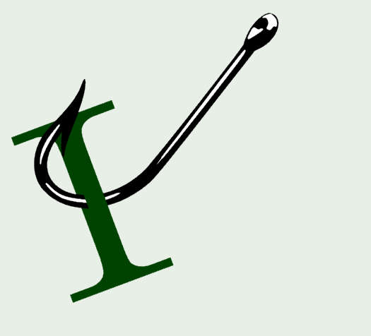

## Security

[eMudhra's certificate blunder leaves enterprises with a lot of cleanup](https://marybranscombe.leaflet.pub/3myikkn2tec2y?utm_source=blog.peterritchie.com) by Mary Branscombe

[How bug bounty sharpens one researcher’s security skills](https://github.blog/security/how-bug-bounty-sharpens-one-researchers-security-skills/?utm_source=blog.peterritchie.com) by The GitHub Blog

[True data sovereignty isn’t where it’s kept, but who has access to it](https://marybranscombe.leaflet.pub/3mydgapwmdc2l?utm_source=blog.peterritchie.com) by Mary Branscombe

<!-- ## Open-source

## Domain-Driven Design, CQRS

 -->
## Software Architecture

[The bridge to agent-scale Git infrastructure](https://github.blog/engineering/architecture-optimization/the-bridge-to-agent-scale-git-infrastructure/?utm_source=blog.peterritchie.com) by The GitHub Blog

[5 Event Driven Architecture Problems (And How to Avoid Them)](https://codeopinion.com/event-driven-architecture-problems/?utm_source=blog.peterritchie.com) by Derek Comartin

[Thoughts on Dynamic Consistency Boundary](https://www.architecture-weekly.com/p/thoughts-on-dynamic-consistency-boundary?utm_source=blog.peterritchie.com) by Oskar Dudycz

<!-- ## GitHib

## Presenting
 -->
## .NET

[.NET October 2026 Out-of-Band Security Updates](https://devblogs.microsoft.com/dotnet/dotnet-october-2026-oob-security-updates/?utm_source=blog.peterritchie.com) by .NET Team

[Adding a Razor Page with Entity Framework Core to an ASP.NET Core Project](https://dev.to/karenpayneoregon/adding-a-razor-page-with-entity-framework-core-to-an-aspnet-core-project-1p2g?utm_source=blog.peterritchie.com) by Karen Payne

[Revoke a JWT Before It Expires: Refresh Tokens and token_version in ASP.NET Core](https://milanjovanovic.tech/blog/revoke-jwt-before-it-expires-token-version?utm_source=blog.peterritchie.com) by Milan Jovanović

[SHOW ME WHAT YOU GOT: From Behaviour to Recommendations in C# (English)](https://www.mostlylucid.net/blog/show-me-what-you-got-part2-building-relevance?utm_source=blog.peterritchie.com) by Scott Galloway

[Are You Getting Everything You Can from Your Visual Studio Subscription?](https://devblogs.microsoft.com/visualstudio/what-should-we-blog-about-next/?utm_source=blog.peterritchie.com) by Visual Studio Blog

[Saving the Game: System.Text.Json and Union State](https://blog.nimblepros.com/blogs/saving-the-game-system-text-json-and-union-state/?utm_source=blog.peterritchie.com) by Sarah Dutkiewicz

[.NET 11 and the Critter Stack](https://jeremydmiller.com/2026/10/21/net-11-and-the-critter-stack/?utm_source=blog.peterritchie.com) by Jeremy D. Miller

[Compare today's code with an earlier commit](https://devblogs.microsoft.com/visualstudio/compare-todays-code-with-an-earlier-commit/?utm_source=blog.peterritchie.com) by Visual Studio Blog

[An introduction to Compact Binary Object Representation (CBOR) in .NET](https://andrewlock.net/an-introduction-to-compact-binary-object-notation-in-dotnet/?utm_source=blog.peterritchie.com) by Andrew Lock

[Closed Hierarchies in C# 15: Every Victory Condition Accounted For](https://blog.nimblepros.com/blogs/closed-hierarchies-in-csharp-15-every-victory-condition-accounted-for/?utm_source=blog.peterritchie.com) by Sarah Dutkiewicz

[Storing and Querying a Hierarchy of Types with Marten](https://jeremydmiller.com/2026/10/19/storing-and-querying-a-hierarchy-of-types-with-marten/?utm_source=blog.peterritchie.com) by Jeremy D. Miller

[Bring Your Own Model to the GitHub Copilot SDK with C#](https://devblogs.microsoft.com/dotnet/bring-your-own-model-to-the-github-copilot-sdk-with-csharp/?utm_source=blog.peterritchie.com) by .NET Team

[Organize and revisit tabs with the keyboard](https://devblogs.microsoft.com/visualstudio/organize-and-revisit-tabs-with-the-keyboard/?utm_source=blog.peterritchie.com) by Visual Studio Blog

[Spectre.Console Tree widget](https://dev.to/karenpayneoregon/spectreconsole-tree-widget-3j00?utm_source=blog.peterritchie.com) by Karen Payne

[Wolverine passed 10 million downloads](https://jeremydmiller.com/2026/10/18/wolverine-passed-10-million-downloads/?utm_source=blog.peterritchie.com) by Jeremy D. Miller

<!-- ## Conferences and Speaking

## Domain Driven Design

## DevOps

## Software Design

## Mobile

## Agile/Work Life

## Project Management/Administration

 -->
## REST/APIs

[We Did Not Skip Hypermedia, We Moved It Out Of The Response](https://apievangelist.com/2026/10/22/we-did-not-skip-hypermedia-we-moved-it-out-of-the-response/?utm_source=blog.peterritchie.com) by Kin Lane

[Breaking Change Detection in OpenAPI](https://apisyouwonthate.com/blog/breaking-change-detection-in-openapi/?utm_source=blog.peterritchie.com) by Phil Sturgeon

## Azure

[Code with Cosmos: Build a Production-Ready AI App in Four Episodes](https://devblogs.microsoft.com/cosmosdb/code-with-cosmos/?utm_source=blog.peterritchie.com) by Azure Cosmos DB Blog

[From Local Development to CI Workflows with the Azure Cosmos DB Emulator](https://devblogs.microsoft.com/cosmosdb/from-local-development-to-ci-workflows-with-the-azure-cosmos-db-emulator/?utm_source=blog.peterritchie.com) by Azure Cosmos DB Blog

[Introducing Agentic Autofix for code and dependencies](https://devblogs.microsoft.com/devops/introducing-agentic-autofix-for-code-and-dependencies/?utm_source=blog.peterritchie.com) by Azure DevOps Blog

[Announcing GA of Safe Key Rotation in Azure Cosmos DB](https://devblogs.microsoft.com/cosmosdb/announcing-public-preview-of-safe-key-rotation-in-azure-cosmos-db/?utm_source=blog.peterritchie.com) by Azure Cosmos DB Blog

[Azure DevOps available in Microsoft Copilot Cowork](https://devblogs.microsoft.com/devops/azure-devops-available-in-microsoft-copilot/?utm_source=blog.peterritchie.com) by Azure DevOps Blog

## Software Development

[Small models, specific purposes](https://www.poppastring.com/blog/small-models-specific-purposes?utm_source=blog.peterritchie.com) by Mark Downie

[Properties for a budgeting exercise](https://blog.ploeh.dk/2026/10/19/properties-for-a-budgeting-exercise/?utm_source=blog.peterritchie.com) by Mark Seemann

<!-- ## Windows
-->
## AI

[Making the Copilot Key Open Claude](https://blog.lhotka.net/2026/10/22/Copilot-Key-Opens-Claude?utm_source=blog.peterritchie.com) by Rockford Lhotka

[Using GenAI as a Thinking Partner and not a Replacement for Your Thinking](https://agilepainrelief.com/blog/using-gen-ai-as-a-thinking-partner-and-not-a-replacement-for-your-thinking/?utm_source=blog.peterritchie.com) by Mark Levison

[Automating Spec to PR with Mastra AI](https://nick-tune.me/blog/2026-10-20-automating-spec-to-pr-with-mastra-ai/?utm_source=blog.peterritchie.com) by Nick Tune

<!--## Online Tools

## Databases

## Computing

## Podcasts

## Other Link Collections

-->
