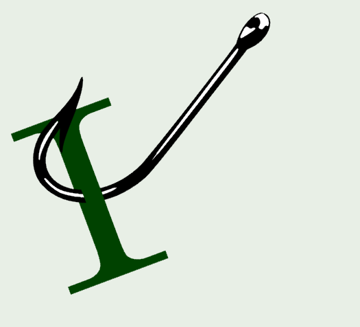

<!-- ## Security

## Open-source

## Domain-Driven Design, CQRS

 -->
## Software Architecture

[Inside GitHub's new Git storage architecture](https://github.blog/engineering/architecture-optimization/inside-githubs-new-git-storage-architecture/?utm_source=blog.peterritchie.com) by The GitHub Blog

<!-- ## GitHib

## Presenting

-->
## .NET

[Outbox Pattern in .NET With Postgres: Concurrent Workers vs the WAL](https://milanjovanovic.tech/blog/outbox-pattern-postgres-workers-vs-wal?utm_source=blog.peterritchie.com) by Milan Jovanović

[Tiles and Tokens - Part 2: Discriminated Unions in C# 15: A Turn is Exactly One Thing (video)](https://www.youtube.com/watch?v=n7P1jkv9v7Q?utm_source=blog.peterritchie.com) by NimblePros

[Fix package vulnerabilities with GitHub Copilot #visualstudio #githubcopilot (video)](https://www.youtube.com/shorts/_s5TJuUnK84?utm_source=blog.peterritchie.com) by Microsoft Visual Studio

[A day in the life building a Critter Stack release w/ AI](https://jeremydmiller.com/2026/11/05/a-day-in-the-life-building-a-critter-stack-release-w-ai/?utm_source=blog.peterritchie.com) by Jeremy D. Miller

[Modernize your .NET apps for Windows Arm64 with GitHub Copilot](https://devblogs.microsoft.com/dotnet/modernize-dotnet-apps-for-windows-arm64/?utm_source=blog.peterritchie.com) by .NET Team

[EF Core 11 Part I: Migrations Get Friendlier for Teams](https://blog.nimblepros.com/blogs/ef-core-11-migrations/?utm_source=blog.peterritchie.com) by Barret Blake

[Sync vs Async File I/O in .NET: Raw Throughput, Scalability, and Buffer Size](https://www.meziantou.net/sync-vs-async-file-i-o-in-dotnet-raw-throughput-scalability-and-buffer-size.htm?utm_source=blog.peterritchie.com) by Gérald Barré

[Tiles and Tokens - Part 1: Rolling Into .NET 11: Modeling a Board Game with C# 15 (video)](https://www.youtube.com/watch?v=kEpWqcj8pmU?utm_source=blog.peterritchie.com) by NimblePros

[Flow-based specifications with Bobcat](https://jeremydmiller.com/2026/11/03/flow-based-specifications-with-bobcat/?utm_source=blog.peterritchie.com) by Jeremy D. Miller

[Delivering Skills in NuGet packages](https://devblogs.microsoft.com/dotnet/delivering-skills-in-nuget-packages/?utm_source=blog.peterritchie.com) by .NET Team

[Migrating to runtime async](https://www.meziantou.net/migrating-to-runtime-async.htm?utm_source=blog.peterritchie.com) by Gérald Barré

[Understanding Lazy<T> thread safety modes](https://andrewlock.net/understanding-lazy-thread-safety-modes/?utm_source=blog.peterritchie.com) by Andrew Lock

[The Rest of C# 15: The Smaller Features Worth Knowing](https://blog.nimblepros.com/blogs/csharp-15-smaller-features/?utm_source=blog.peterritchie.com) by Barret Blake

[Aspire 2026 Revisit, Episode 1 - Overview (video)](https://www.youtube.com/watch?v=x502JtWKCLg?utm_source=blog.peterritchie.com) by NimblePros

[Faster navigation with Code and Feature Search  #visualstudio #visualstudiotips (video)](https://www.youtube.com/shorts/ogY6a58NM3Q?utm_source=blog.peterritchie.com) by Microsoft Visual Studio

<!-- ## Conferences and Speaking

## Domain Driven Design

## DevOps

## Software Design

## Mobile

 -->
## Agile/Work Life

[Three Questions for Every User Story](https://mamund.substack.com/p/three-questions-for-every-user-story?utm_source=blog.peterritchie.com) by Mike Amundsen

<!--## Project Management/Administration

 -->
## REST/APIs

[OpenLint is here to automate your API Style Guides](https://apisyouwonthate.com/newsletter/openlint-is-here-to-automate-your-api-style-guides/?utm_source=blog.peterritchie.com) by Alexander Karan

## Azure

[Azure App Service Community Standup:  Platform Release Channels & WebSSH for Custom Containers (video)](https://www.youtube.com/watch?v=tGJeW7MKL9I?utm_source=blog.peterritchie.com) by Microsoft Azure Developers

## Software Development

[Hacking a new home screen for my Samsung TV](https://cassidoo.co/post/hacking-samsung-tv-screen/?utm_source=blog.peterritchie.com) by Cassidy Williams

<!-- ## Windows
-->
## AI

[Julie Downey on Dragon Copilot [EPISODE 922] (video)](https://www.youtube.com/watch?v=uUDU3NmJLSA?utm_source=blog.peterritchie.com) by Technology and Friends

[When Your Copilot Session Follows You Everywhere, So Must Your Governance](https://www.mitchelsellers.com/blog/article/when-your-copilot-session-follows-you-everywhere-so-must-your-governance?utm_source=blog.peterritchie.com) by Mitchel Sellers

[Kevin Griffin on Using AI to Manage a Legacy Code Base [EPISODE 931] (video)](https://www.youtube.com/watch?v=sL9P_Uan96M?utm_source=blog.peterritchie.com) by Technology and Friends

[Matthew Renze on Best Practices When Working With AI Agents [EPISODE 930] (video)](https://www.youtube.com/watch?v=K0resaLrTJo?utm_source=blog.peterritchie.com) by Technology and Friends

[Making the migration affordable](https://www.poppastring.com/blog/making-the-migration-affordable?utm_source=blog.peterritchie.com) by Mark Downie

[Is AI the next layer of abstraction?](https://blog.ploeh.dk/2026/11/02/is-ai-the-next-layer-of-abstraction/?utm_source=blog.peterritchie.com) by Mark Seemann

<!--## Online Tools

## Databases

## Computing

## Podcasts

## Other Link Collections

-->

