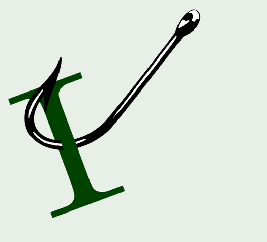

## Security

[Git security vulnerabilities announced](https://github.blog/open-source/git/git-security-vulnerabilities-announced-7/?utm_source=blog.peterritchie.com) by The GitHub Blog

<!-- ## Open-source

## Domain-Driven Design, CQRS

 -->
## Software Architecture

[Stale Data Is More Than an Eventual Consistency Problem](https://codeopinion.com/stale-data-consistency-boundaries/?utm_source=blog.peterritchie.com) by Derek Comartin

## GitHib

[GitHub availability report: October 2026](https://github.blog/news-insights/company-news/github-availability-report-october-2026/?utm_source=blog.peterritchie.com) by The GitHub Blog

[How to deliver real data sovereignty](https://marybranscombe.leaflet.pub/3mzyauplau22u?utm_source=blog.peterritchie.com) by Mary Branscombe

<!-- ## Presenting

-->
## .NET

[EF 11 Split Query Performance: The Redundant Reference Join Is Gone, Measured on PostgreSQL](https://milanjovanovic.tech/blog/ef-core-11-split-query-redundant-join?utm_source=blog.peterritchie.com) by Milan Jovanović

[Critter Stack on .NET 11 and a Stoat Demo (video)](https://www.youtube.com/watch?v=FILw-zVgqhY?utm_source=blog.peterritchie.com) by JasperFx Software

[European Law for .NET Developers: Your Apps with the European Accessibility Act](https://dev.to/lovelacecoding/european-law-for-net-developers-your-apps-with-the-european-accessibility-act-12on?utm_source=blog.peterritchie.com) by Lou Creemers

[Brian Hitney on Fabric Apps [EPISODE 923] (video)](https://www.youtube.com/watch?v=h7dnvO8O6kU?utm_source=blog.peterritchie.com) by Technology and Friends

[Tiles and Tokens -  Part 5: EF Core 11: Querying Deeply Nested Game State Without Schema Friction (video)](https://www.youtube.com/watch?v=GdQFFh0xVfk?utm_source=blog.peterritchie.com) by NimblePros

[C# 15 Labeled Break Continue](https://blog.ndepend.com/c-15-labeled-break-continue/?utm_source=blog.peterritchie.com) by NDepend

[C# 15 Closed Hierarchies](https://blog.ndepend.com/c-15-closed-hierarchies/?utm_source=blog.peterritchie.com) by NDepend

[Where Did My Order Go? Tracing One Request Across Services | CritterWatch in Practice #2 (video)](https://www.youtube.com/watch?v=DS_5U9rQkVY?utm_source=blog.peterritchie.com) by JasperFx Software

[When Messages Die: Dead Letter Triage with AI | CritterWatch in Practice #1 (video)](https://www.youtube.com/watch?v=5iWi8quh9cU?utm_source=blog.peterritchie.com) by JasperFx Software

[Async Validation in ASP.NET Core 11](https://blog.nimblepros.com/blogs/async-validation-aspnet-core-11/?utm_source=blog.peterritchie.com) by NimblePros

[Recap from World Usability Day 2026](https://sadukie.com/2026/11/12/world-usability-day-recap.html?utm_source=blog.peterritchie.com) by Sarah Dutkiewicz

[What I think so far about Spec Driven Development](https://jeremydmiller.com/2026/11/11/what-i-think-so-far-about-spec-driven-development/?utm_source=blog.peterritchie.com) by Jeremy D. Miller

[Bring Your Own Model is now generally available in Visual Studio](https://devblogs.microsoft.com/visualstudio/bring-your-own-model-is-now-generally-available-in-visual-studio/?utm_source=blog.peterritchie.com) by Visual Studio Blog

[Tiles and Tokens - Part 4:  Saving the Game: System.Text.Json and Union State (video)](https://www.youtube.com/watch?v=rPGXUdBwUDc?utm_source=blog.peterritchie.com) by NimblePros

[File-Based Apps in .NET 11: Room to Grow](https://barretblake.dev/posts/development/2026/11/file-based-apps-dotnet-11/?utm_source=blog.peterritchie.com) by Barret Blake

[Adopt .NET 11 Without Surprises: Build a Canary Pipeline](https://www.mitchelsellers.com/blog/article/adopt-net-11-without-surprises-build-a-canary-pipeline?utm_source=blog.peterritchie.com) by Mitchel Sellers

[Tiles and Tokens - Part 1: Rolling Into .NET 11: Modeling a Board Game with C# 15 (video)](https://www.youtube.com/watch?v=kEpWqcj8pmU?utm_source=blog.peterritchie.com) by NimblePros

[Tiles and Tokens - Part 3: Closed Hierarchies in C# 15: Every Victory Condition Accounted For (video)](https://www.youtube.com/watch?v=_XOQdt2GOU0?utm_source=blog.peterritchie.com) by NimblePros

[Announcing Visual Studio 2026 LTSC 18.11](https://devblogs.microsoft.com/visualstudio/announcing-visual-studio-2026-ltsc-1811/?utm_source=blog.peterritchie.com) by Visual Studio Blog

[Announcing .NET 11](https://devblogs.microsoft.com/dotnet/announcing-dotnet-11/?utm_source=blog.peterritchie.com) by .NET Team

[.NET and .NET Framework November 2026 servicing updates](https://devblogs.microsoft.com/dotnet/dotnet-and-dotnet-framework-november-2026-servicing-updates/?utm_source=blog.peterritchie.com) by .NET Team

[EF Core 11 Part II: Faster Queries and SQL Server Upgrades](https://blog.nimblepros.com/blogs/ef-core-11-performance-sql-server/?utm_source=blog.peterritchie.com) by NimblePros

[Copilot in Visual Studio Just Got a Major Upgrade](https://devblogs.microsoft.com/visualstudio/copilot-in-visual-studio-just-got-a-major-upgrade/?utm_source=blog.peterritchie.com) by Visual Studio Blog

[On EventStorming, collaboration, LLMs and how to glue that](https://www.architecture-weekly.com/p/on-eventstorming-collaboration-llms?utm_source=blog.peterritchie.com) by Oskar Dudycz

[Tiles and Tokens - Part 2: Discriminated Unions in C# 15: A Turn is Exactly One Thing (video)](https://www.youtube.com/watch?v=n7P1jkv9v7Q?utm_source=blog.peterritchie.com) by NimblePros

[Speed up CI builds with Meziantou.DeltaBuild](https://www.meziantou.net/speed-up-ci-builds-with-meziantou-deltabuild.htm?utm_source=blog.peterritchie.com) by Gérald Barré

[Long Running Workflows and Saga Improvements for Wolverine and CritterWatch (video)](https://www.youtube.com/watch?v=JvZb5G5hs94?utm_source=blog.peterritchie.com) by JasperFx Software

[Fix package vulnerabilities with GitHub Copilot (video)](https://www.youtube.com/shorts/_s5TJuUnK84?utm_source=blog.peterritchie.com) by Microsoft Visual Studio

<!-- ## Conferences and Speaking

## Domain Driven Design

## DevOps

## Software Design

## Mobile

## Agile/Work Life

## Project Management/Administration

## REST/APIs

## Azure

 -->
## Software Development

[Building Kakuro Zone](https://cassidoo.co/post/kakuro-zone-game/?utm_source=blog.peterritchie.com) by Cassidy Williams

[Veterans Day 2026 - About Vets Who Code](https://sadukie.com/2026/11/11/vetswhocode.html?utm_source=blog.peterritchie.com) by Sarah Dutkiewicz

[QuickCheck property: Forced category limit applies](https://blog.ploeh.dk/2026/11/09/quickcheck-property-forced-category-limit-applies/?utm_source=blog.peterritchie.com) by Mark Seemann

<!-- ## Windows
-->
## AI

[Build once, run on any agent: A practical guide to agent skills](https://github.blog/ai-and-ml/github-copilot/build-once-run-on-any-agent-a-practical-guide-to-agent-skills/?utm_source=blog.peterritchie.com) by The GitHub Blog

[The RockBot Ecosystem](https://blog.lhotka.net/2026/11/12/The-RockBot-Ecosystem?utm_source=blog.peterritchie.com) by Rockford Lhotka

<!--## Online Tools

## Databases

## Computing

## Podcasts

## Other Link Collections

-->
## Community

[The Shy Kid Who Did Not Speak](https://woodruff.dev/blog/the-shy-kid-who-did-not-speak/?utm_source=blog.peterritchie.com) by Chris Woody Woodruff

