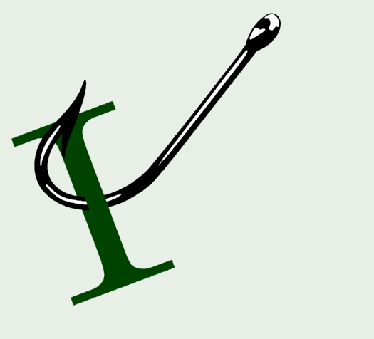

<!-- ## Security

 -->
## Open-source

[Maintainers don't need more AI bug reports. They need fixes.](https://github.blog/open-source/maintainers/maintainers-dont-need-more-ai-bug-reports-they-need-fixes/?utm_source=blog.peterritchie.com) by The GitHub Blog

<!-- ## Domain-Driven Design, CQRS

 -->
## Software Architecture

[Make the change easy, then make the easy change](https://www.architecture-weekly.com/p/make-the-change-easy-then-make-the?utm_source=blog.peterritchie.com) by Oskar Dudycz

<!-- ## GitHib

## Presenting

-->
## .NET

[Build only what changed in your .NET monorepo with dotnet-affected](https://stenbrinke.nl/blog/build-only-what-changed-in-your-dotnet-monorepo/?utm_source=blog.peterritchie.com) by Sander ten Brinke

[Exporting Breakpoints (video)](https://www.youtube.com/shorts/P0EetBpZDFs?utm_source=blog.peterritchie.com) by Microsoft Visual Studio

[Debugging a running .NET application with WinDbg and an AI agent](https://www.meziantou.net/debugging-a-running-dotnet-application-with-windbg-and-an-ai-agent.htm?utm_source=blog.peterritchie.com) by Gérald Barré

[ASP.NET Core 11 loves OpenTelemetry (video)](https://www.youtube.com/watch?v=3mAhtBjBW88?utm_source=blog.peterritchie.com) by dotnet

[Extending FluentValidation library](https://dev.to/karenpayneoregon/extending-fluentvalidation-library-4fhg?utm_source=blog.peterritchie.com) by Karen Payne

[Finding a leak rooted by an event handler or a timer with an AI agent](https://www.meziantou.net/finding-a-leak-rooted-by-an-event-handler-or-a-timer-with-an-ai-agent.htm?utm_source=blog.peterritchie.com) by Gérald Barré

[CritterWatch, take 2! (video)](https://www.youtube.com/watch?v=Iw5m47eyKf8?utm_source=blog.peterritchie.com) by JasperFx Software

[C# 15 Union Types vs the Result Pattern in a Use Case](https://milanjovanovic.tech/blog/csharp-union-types-vs-result-pattern?utm_source=blog.peterritchie.com) by Milan Jovanović

[Lessons from Blazor WASM in Production (video)](https://www.youtube.com/watch?v=uUJztTsg-SY?utm_source=blog.peterritchie.com) by dotnet

[Finding a memory leak in a .NET dump with an AI agent](https://www.meziantou.net/finding-a-memory-leak-in-a-dotnet-dump-with-an-ai-agent.htm?utm_source=blog.peterritchie.com) by Gérald Barré

[Refactor AI Slop Into Proper Types (video)](https://www.youtube.com/watch?v=J4oWyIV3xA0?utm_source=blog.peterritchie.com) by Zoran on C#

[.NET 11 for .NET Devs - The Other Stuff - Episode 3 - EF Core Queries (video)](https://www.youtube.com/watch?v=nqVi_obCy_o?utm_source=blog.peterritchie.com) by NimblePros

[Apply custom themes in Visual Studio (video)](https://www.youtube.com/watch?v=XE8Fqon86l8?utm_source=blog.peterritchie.com) by Mads Kristensen

[Solved! Combine Solution Explorer with File Explorer (video)](https://www.youtube.com/watch?v=JSBKPPRVXro?utm_source=blog.peterritchie.com) by Mads Kristensen

[Long Running Workflows and Saga Improvements for Wolverine and CritterWatch (video)](https://www.youtube.com/watch?v=JvZb5G5hs94?utm_source=blog.peterritchie.com) by JasperFx Software

[Speed up Visual Studio's startup time with this trick (video)](https://www.youtube.com/watch?v=xdd15okjeZ8?utm_source=blog.peterritchie.com) by Mads Kristensen

[Diagnosing thread pool starvation from a .NET dump with an AI agent](https://www.meziantou.net/diagnosing-thread-pool-starvation-from-a-dotnet-dump-with-an-ai-agent.htm?utm_source=blog.peterritchie.com) by Gérald Barré

[What's New in the .NET 11 CLI](https://blog.nimblepros.com/blogs/dotnet-11-cli-updates/?utm_source=blog.peterritchie.com) by Barret Blake

[Finding a deadlock in a .NET dump with an AI agent](https://www.meziantou.net/finding-a-deadlock-in-a-dotnet-dump-with-an-ai-agent.htm?utm_source=blog.peterritchie.com) by Gérald Barré

[Finding an async deadlock caused by a SynchronizationContext with an AI agent](https://www.meziantou.net/finding-an-async-deadlock-caused-by-a-synchronizationcontext-with-an-ai-agent.htm?utm_source=blog.peterritchie.com) by Gérald Barré

[45 Real Bugs Found in Open Source .NET Code While Testing NDepend.AI](https://blog.ndepend.com/45-real-bugs-found-in-open-source-net-code-while-testing-ndepend-ai/?utm_source=blog.peterritchie.com) by NDepend

[Introducing staged publishing on NuGet.org](https://devblogs.microsoft.com/dotnet/nuget-staged-publishing/?utm_source=blog.peterritchie.com) by .NET Team

[What's new in .NET 11 Numerics](https://blog.ndepend.com/net-11-numerics/?utm_source=blog.peterritchie.com) by NDepend

[.NET 11 C# File-Based Apps](https://blog.ndepend.com/csharp-file-based-apps/?utm_source=blog.peterritchie.com) by NDepend

<!-- ## Conferences and Speaking

## Domain Driven Design

## DevOps

## Software Design

## Mobile

## Agile/Work Life

## Project Management/Administration

## REST/APIs

 -->
## Azure

[Azure Logic Apps Live: October 2026 Community Call (video)](https://www.youtube.com/watch?v=KKo1CMY1epQ?utm_source=blog.peterritchie.com) by Microsoft Azure Developers

[Copilot Code Reviews for Azure Repos is generally available](https://devblogs.microsoft.com/devops/copilot-code-reviews-for-azure-repos-is-generally-available/?utm_source=blog.peterritchie.com) by Azure DevOps Blog

[Rethinking Microservices with Orleans (video)](https://www.youtube.com/watch?v=Sj6tz0lZNm8?utm_source=blog.peterritchie.com) by dotnet

[Miniservices not Microservices in Azure (video)](https://www.youtube.com/watch?v=9UbzM5WbZkk?utm_source=blog.peterritchie.com) by dotnet

[Azure DevOps integration with the GitHub Copilot app (public preview)](https://devblogs.microsoft.com/devops/azure-devops-integration-with-the-github-copilot-app-public-preview/?utm_source=blog.peterritchie.com) by Azure DevOps Blog

[Azure Cosmos DB Developer Tools and AI Agent Integration](https://devblogs.microsoft.com/cosmosdb/azure-cosmos-db-ai-agent-developer-tools/?utm_source=blog.peterritchie.com) by Azure Cosmos DB Blog

## Software Development

[Manage Docker And Kubernetes Environments And Back Them Up With Portainer](https://apievangelist.com/2026/11/21/manage-docker-and-kubernetes-environments-and-back-them-up-with-portainer/?utm_source=blog.peterritchie.com) by Kin Lane

[Top-Down or Bottom-Up: How to Explain Code and Tech So People Actually Get It](https://dev.to/lovelacecoding/top-down-or-bottom-up-how-to-explain-code-and-tech-so-people-actually-get-it-1a7n?utm_source=blog.peterritchie.com) by Lou Creemers

[Worse is better: async/await versus syntactic sugar for monadic composition](https://blog.ploeh.dk/2026/11/16/worse-is-better-asyncawait-versus-syntactic-sugar-for-monadic-composition/?utm_source=blog.peterritchie.com) by Mark Seemann

<!-- ## Windows
-->
## AI

[Moving to HTML-based collaboration with agents](https://nick-tune.me/blog/2026-11-21-moving-to-html-based-collaboration-with-agents/?utm_source=blog.peterritchie.com) by Nick Tune

[Gaines Kergosien on AI Governance, Security, and Adoption Challenges [EPISODE 926] (video)](https://www.youtube.com/watch?v=iW8zZdKLw2w?utm_source=blog.peterritchie.com) by Technology and Friends

[Michael Collier on Durable Agents [EPISODE 924] (video)](https://www.youtube.com/watch?v=u94ICpZtSLI?utm_source=blog.peterritchie.com) by Technology and Friends

[AI is Changing the Cross-Platform Decision Matrix](https://devblogs.microsoft.com/dotnet/ai-cross-platform-decision-matrix/?utm_source=blog.peterritchie.com) by .NET Team

<!--## Online Tools

## Databases

## Computing

## Podcasts

## Other Link Collections

## Community
-->
